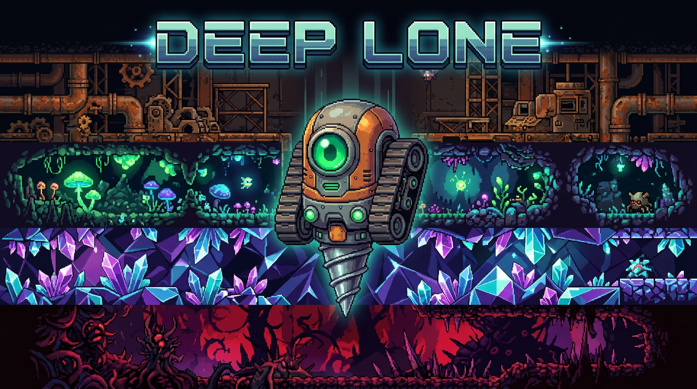

# UnderDeep — Deep Lone

**2D Drill Roguelite про маленького гусеничного дрона LONE-1.** 
Двигатель: Unity 6 (6000.3.7f1) URP 2D. Платформы: WebGL — Яндекс Игры, VK Play, Standalone.

> 🎮 Логлайн: Ты — последний буровой дроид на заброшенной колонии Кора-7. Добудь ресурсы, обменивай на апгрейды на базе и спустись к ядру (1000м), где тебя ждут голоса в голове и два финала.




---

## Быстрый старт — vertical slice

1. Открой проект в **Unity 6000.3.7f1**.
2. Build Settings уже содержит сцены `Boot`, `Base`, `Run` по порядку.
3. Нажми Play на `Boot`; в редакторе используется `StandaloneProvider`.
4. На базе нажми «Начать забег». Временный `VerticalSliceBootstrap` создаёт шахту, дроида и HUD при загрузке сцен.
5. Движение: WASD / стрелки. **W + Space** — бурить вверх; ЛКМ — бурить соседний блок; **B** — эвакуация.

Срез пока не проверен в Unity Play Mode/WebGL в этом окружении. См. [Docs/QUICKSTART.md](Docs/QUICKSTART.md) и [Docs/VERTICAL_SLICE.md](Docs/VERTICAL_SLICE.md).

### Управление

| Действие | Клавиатура | Мышь/Тач |
|----------|------------|----------|
| Движение | WASD / стрелки | — |
| Бурить в vertical slice | W + Space (вверх) | Клик по соседнему тайлу |
| Пополнить топливо | R (1 кристалл → +15 топлива) | Кнопка в HUD |
| Эвакуация | B / кнопка ЭВАКУАЦИЯ | — |
| Био-гель (лечение −30 санити) | E | — |

---

## Целевой MVP (не весь функционал подключён)

Перечень ниже — дизайн-цель и заготовки систем, а не список проверенных возможностей сборки. Сейчас реализуется и проверяется ограниченный vertical slice: база, шахта, бурение, ресурсы и эвакуация/смерть.

**Планируемый мир 50×100, 6 биомов** (0-10 поверхность, 10-20 металл, 20-40 био-пещеры, 40-70 кристаллы, 70-90 заражение, 90-100 ядро) — перлин-кластеры, жилы RustMetal, TrapSystem.

**Блоки**: Dirt/Stone/RustMetal/CrystalOre/BioGel/GasVein/Wire/CrystalWall/Bedrock/ArtifactChunk + дроп (см. `BALANCE.md`)

**Дрон LONE-1**: топливо 100+20/батарея, перегрев 100°→стан 3с, безумие 0-100 (см. ниже), 3 HP + щит, фонарик Point Light2D (flicker, цвет от глубины)

**Безумие**:
- 25% vignette + хроматика, 50% фейк-руды (6 шт), 75% фейк-враги (Hallucination), 100% blackout 5с. Шёпоты раз в 12с. Свет ×0.6 набора, био-гель −30.

**Враги**:
- **RustWorm** (50-200м) — по прямой, ломает блоки
- **Firefly** (200-400м) — орбита 3, knockback 5, +8 санити
- **CrystalSpider** (400-700м) — прячется в кристаллах, рывок
- **Hallucination** (700-900м) — сквозь стены, +15 санити, life 8с

**Ловушки**: газ (яд 0.5с×3с), провода (стан 0.6с), обвалы (FallingRock 6 u/s, 12% шанс)

**Прогрессия**: 6 апгрейдов (MK2 50 Rust, MK3 150 Rust+30 Crystal, батареи 40 Crystal, радар 80 Rust, магнит 100+10 Bio, щит 200+50), 5 артефактов по 1 на 20м (перки), 2 финала (жертва/побег) + InfiniteMode

**UI**: HUD (fuel/heat/sanity/Whispers), BaseShop, DeathScreen (revive rewarded), RadarVision (подсветка кристаллов), ScreenShake, VFX/AudioManager

---

## Контракт агентов

Главный документ: **[Docs/AGENTS_CONTRACT.md](Docs/AGENTS_CONTRACT.md)** — обязателен к прочтению перед любым PR.

Коротко:
- 9 ролей (Architect, World, Player, Enemies, Progression, UI, Platform, TechArt, QA) — каждая владеет своей папкой.
- Все платформенные вызовы только через `IPlatformProvider` (Yandex/VK/Standalone).
- Мир: `WorldGrid` — источник истины, `Tilemap` — вью.
- Сохранения: `MetaSave` (постоянное) + `RunSave` (в памяти, сбрасывается при смерти).
- События через `EventBus` (struct, zero-GC).

Другие доки:
- [ARCHITECTURE.md](Docs/ARCHITECTURE.md) — диаграммы, поток бурения
- [BALANCE.md](Docs/BALANCE.md) — числа добычи, биомы, цены
- [PLATFORM.md](Docs/PLATFORM.md) — Yandex SDK / VK Bridge / WebGL требования
- [VFX_LIGHTING.md](Docs/VFX_LIGHTING.md) — свет/частицы/ловушки/безумие
- [YANDEX_INTEGRATION.md](Docs/YANDEX_INTEGRATION.md) — чек-лист публикации
- [SCENES.md](Docs/SCENES.md) — состав сцен
- [EVENTS.md](Docs/EVENTS.md) — все ивенты

---

## Структура проекта

```
Assets/_Project/
├── Art/            drone_concept.png, promo_banner.png
├── Core/           EventBus, GameStateMachine, ServiceLocator, SaveService, Audio
├── Scripts/
│   ├── World/      WorldGrid, BiomeDef, BlockDef
│   ├── Player/     DroneController, DrillSystem, Fuel/Heat/Sanity/Health, Inventory, PlayerLight
│   ├── Enemies/    EnemyBase, RustWorm, FireflyGuardian, CrystalSpider, Hallucination, Spawner
│   ├── Progression/UpgradeSystem, ArtifactManager, EndingManager, RunResultHandler
│   ├── UI/         HUD, BaseShop, DeathScreen
│   ├── Platform/   IPlatformProvider, Yandex/VK/Standalone
│   └── Utils/      (без asmdef, видит все модули) Boot, VFXManager, TrapSystem, CaveInSystem, SanityEffects, InfiniteMode,
│                   CameraFollow, RadarVision, ScreenShake, BootWebGLHooks
├── ScriptableObjects/Blocks, Biomes, Upgrades
├── Scenes/         Boot, Base, Run
└── Plugins/WebGL/  YandexSDK.jslib, VKBridge.jslib
```

---

## Платформенный слой (важно для Web)

```csharp
IPlatformProvider provider = PlatformFactory.Create();
await provider.InitAsync();
provider.GameReady(); // ПОСЛЕ загрузки Boot, иначе Яндекс не пустит
await provider.ShowRewardedAsync("revive"); // 1 раз/забег
await provider.ShowRewardedAsync("double_loot");
await provider.SetLeaderboardAsync("maxDepth", depth);
```

- В редакторе — заглушка `StandaloneProvider` (PlayerPrefs, реклама = true в Editor).
- В билде WebGL — автодетект по `Application.absoluteURL`.
- Сохранение <4 КБ JSON, лимит Yandex Storage 10 МБ.

Сборка WebGL: `Brotli`, `Code Opt: Size`, `Exceptions: None`, `Decompression Fallback: true`.

---

## Статус vertical slice

- [x] Добавлена runtime-сборка базовой сцены и сцены забега из `Boot`.
- [x] Добавлены минимальный магазин, шахта, игрок, HUD, бурение, эвакуация и ветка смерти.
- [x] Тесты размещены в Unity test assemblies (`Assets/Tests`).
- [ ] Запустить проект в Unity Editor и проверить Play Mode; тестовый прогон пока не подтверждён.
- [ ] Проверить WebGL билд. Реклама, лидерборды, полный набор биомов/врагов/финалов и production-арт не входят в текущий slice.

Подробный критерий готовности: [Docs/VERTICAL_SLICE.md](Docs/VERTICAL_SLICE.md).

---

## Тесты

- `Assets/Tests/EditMode/WorldTests.cs` — биомы, сохранения, детерминизм, бурение и топливо
- `Assets/Tests/PlayMode/DrillIntegrationTests.cs` — генерация и проходимость шахты

Запуск: `Window → General → Test Runner` в Unity Editor.

---

## Лицензия

MIT

